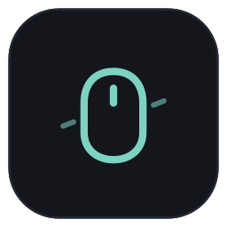
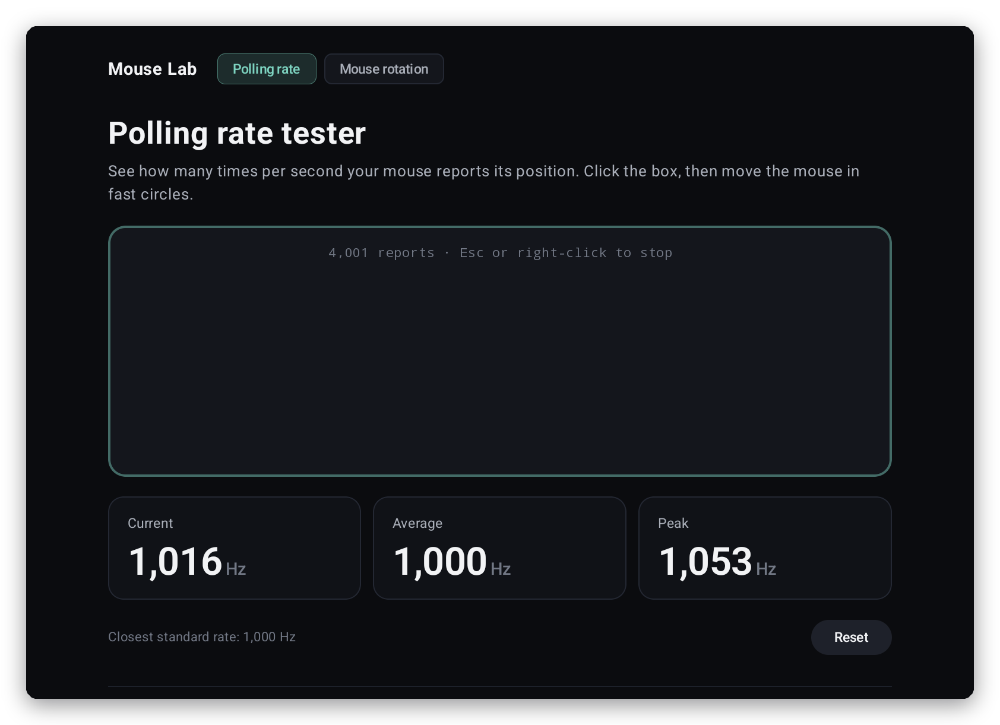
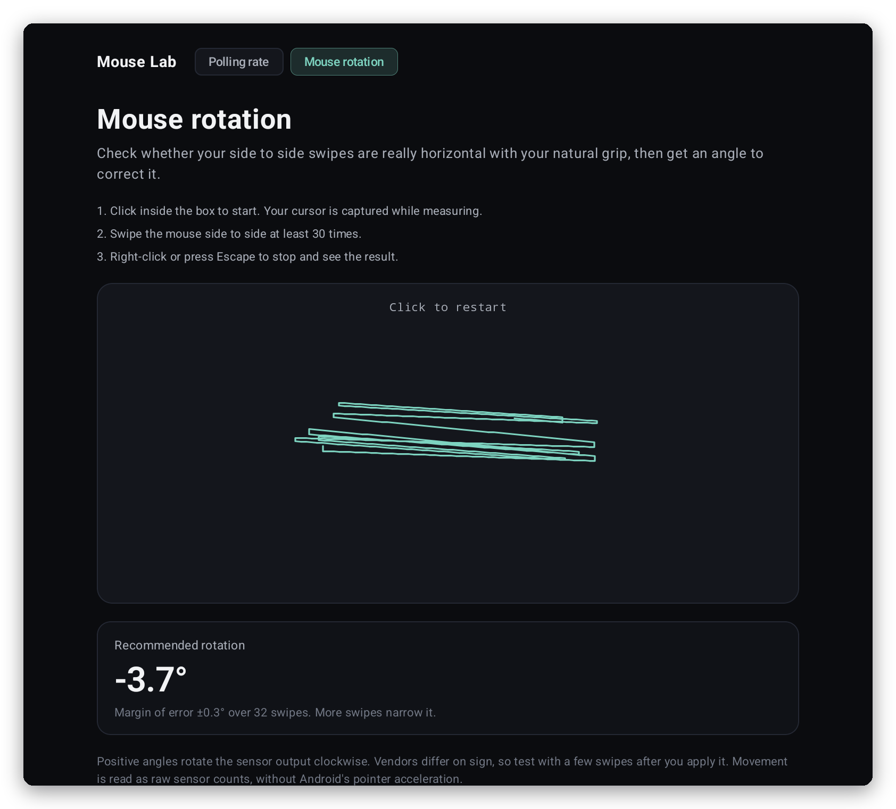

<p align="center">
  
</p>

<h1 align="center">Mouse Lab</h1>

<p align="center">
  <b>Small tools for your mouse, made for Googlebooks.</b><br>
  Measure your mouse's real polling rate, and find the sensor rotation angle that levels your
  swipes. Native ports of the browser tools from <a href="https://openmouse.app/tools">OpenMouse</a>,
  reading raw sensor counts with every report timed by the kernel.
</p>

<p align="center">
  <a href="../../releases/latest/download/MouseLab.apk"><b>⬇ Download MouseLab.apk</b></a>
  &nbsp;·&nbsp; <a href="#install">Install</a>
  &nbsp;·&nbsp; <a href="#privacy">Privacy</a>
  &nbsp;·&nbsp; <a href="CHANGELOG.md">What's new</a>
  &nbsp;·&nbsp; <a href="#licenses">Licenses</a>
</p>

<p align="center">
  
  
  
  
  
</p>

<p align="center"><sub>A personal passion project by <a href="https://github.com/sanjaynathwani-blip">sanjaynathwani-blip</a>, proudly developed entirely on a Googlebook.
Not affiliated with or endorsed by any employer, or by OpenMouse or Google (<a href="#about-this-project">more</a>).</sub></p>

<p align="center">
  
</p>

## What it is

Mouse Lab is a free, open-source app with two tools for checking a mouse, built for the
Googlebook's desktop mode. They're native Android ports of the
[OpenMouse](https://github.com/OpenMouse-Project) project's browser tools, with the same
calculations, so you get the same answers without a browser in the way.

- **Polling rate tester:** how many times per second your mouse reports its position, with the
  current, average and peak rate and the closest standard rate (125 to 8,000 Hz).
- **Mouse rotation:** whether your side-to-side swipes are really level with your natural grip,
  and the angle to set in your mouse's software to correct them, with a margin of error.

## Polling rate tester

Click the box and move the mouse in fast circles. While you measure, the box holds the pointer
(Android's *pointer capture*), so you can't wander off it. Press **Escape** or **right-click** to
stop, and **Reset** to start over.

A browser can only time mouse movement as often as the screen redraws, so web testers can read
low. Mouse Lab reads every report the mouse sends, each with the time the kernel received it, so a
1,000 Hz mouse reads 1,000 Hz. Gaps longer than 100 ms count as pauses in your movement, not as a
slow rate.

## Mouse rotation

<p align="center">
  
  <br><sub>After 32 swipes held about 3.5° clockwise of level: rotate the sensor output by −3.7°, give or take 0.3°.</sub>
</p>

Click the box, swipe side to side at least 30 times with your normal grip, then press **Escape**
or **right-click**. Each swipe is reduced to its net movement, and the tool fits the line your
swipes follow:

    θ = ½ · atan2(2 · Σ dx·dy, Σ dx² − Σ dy²)

The recommended rotation is that line's angle from level. Positive angles rotate the sensor output
clockwise; vendors differ on sign, so check with a few swipes after you apply it. Movement is read
as raw sensor counts, so Android's pointer acceleration doesn't skew it.

## Made for the Googlebook

- **A desktop window** that resizes freely; the readings sit side by side when there's room.
- **Made for a mouse:** click the box to start; **Escape** or **right-click** stops.
- **The touchpad isn't measured,** because it doesn't send mouse reports; Mouse Lab says so if you
  try it. Any USB, wireless or Bluetooth mouse should work.

## Install

Mouse Lab isn't in a store; you install the APK from this page. It takes a minute:

1. On your Googlebook (or any Android 10+ device), download
   **[MouseLab.apk](../../releases/latest/download/MouseLab.apk)**.
2. Open it: click the download in Chrome, or find **MouseLab.apk** in the **Files** app under
   Downloads.
3. The first time, Android asks whether Chrome (or Files) may install apps: choose **Settings**,
   turn on **Allow from this source**, go back and click **Install**.
4. Open **Mouse Lab** from the launcher, plug in a mouse and click the box.

**Updating:** download the new MouseLab.apk and install it over the old one. Every release is
signed with the same key, and Android refuses an update signed with another, so only install
Mouse Lab from this page.

**Checking the download** (optional): each release lists SHA-256 checksums in `SHA256SUMS`; in the
Googlebook's Linux Terminal, `sha256sum MouseLab.apk` prints the one to compare.

## Privacy

- **No permissions at all.** Mouse Lab asks for nothing, not even internet access, so it can't
  send anything anywhere. It has no accounts, analytics or ads.
- **Nothing is kept.** Measurements live only in the open window, and uninstalling removes the app
  completely.

## To do

- [ ] **More mice:** compare readings with a range of real mice and polling rates (8,000 Hz
  especially).
- [ ] **Screen readers:** better TalkBack labels for the measuring box and readings.
- [ ] **Ideas under consideration:** OpenMouse's main feature, changing DPI and polling rate on
  supported mice, would need per-vendor USB protocols on Android, so it isn't planned yet.

Ideas and bug reports are welcome in [Issues](../../issues).

## How it's built

Mouse Lab is plain Android: Kotlin and Jetpack Compose for the interface, and one Android `View`
for the measuring box, so the input path stays short. The box uses
[pointer capture](https://developer.android.com/develop/ui/views/touch-and-input/input-events/pointer-capture)
for raw relative movement, `requestUnbufferedDispatch` so reports arrive as they're sent, and
`MotionEvent.getHistoricalEventTimeNanos` for the time of every report Android batches together.

The calculations in [`app/src/main/java/app/mouselab/tools`](app/src/main/java/app/mouselab/tools)
are a line-for-line port of OpenMouse's `polling-math.ts` and `rotation-math.ts`, and the unit tests
port OpenMouse's tests. The one change: the swipe splitter works incrementally, so the live swipe
count costs the same at 8,000 Hz as at 125 Hz.

```sh
./gradlew assembleDebug          # app/build/outputs/apk/debug/app-debug.apk ("Mouse Lab Dev")
./gradlew testDebugUnitTest      # unit tests
./gradlew assembleRelease        # signed only if ~/.config/mouse-lab/keystore.properties exists
```

It needs JDK 17 and the Android SDK (platform 36). The debug build installs next to the release
one, as **Mouse Lab Dev**. A [GitHub Actions workflow](.github/workflows/build.yml) builds it and
runs the unit tests on every push and pull request. Releases follow [RELEASING.md](RELEASING.md).

## Made on a Googlebook

Mouse Lab was made entirely on a Googlebook, in its built-in Linux Terminal:

- The Terminal's Debian VM runs Gradle and the Android SDK, building and signing the APK.
- The app goes straight onto the same laptop over Wireless debugging, where every change is tried
  for real and checked with `adb` screenshots.
- The readings in these screenshots come from a virtual USB mouse made by code:
  [`tools/vmouse.py`](tools/vmouse.py) registers one through Android's `uinput` tool and sends
  reports at a set rate, or swipes at a set angle, so every result can be checked against a known
  answer. [`tools/readme_images.py`](tools/readme_images.py) turns the window captures into the
  images on this page, and the logo is [`brand/mouse-lab-logo.svg`](brand/mouse-lab-logo.svg).

## About this project

Mouse Lab is my personal passion project, made by me,
[sanjaynathwani-blip](https://github.com/sanjaynathwani-blip), in my own time. It has no
affiliation with my employer: my employer didn't make, sponsor, review or endorse it, and nothing
here speaks for my employer or endorses its products.

The tools and their calculations come from [OpenMouse](https://openmouse.app) by the
OpenMouse-Project contributors
([openmouse-landing-page](https://github.com/OpenMouse-Project/openmouse-landing-page),
`src/pages/tools`, at commit `c963414`). Mouse Lab is an independent port: OpenMouse didn't make or
endorse it, and its name and logo aren't used here. Googlebook and Android are trademarks of
Google LLC, named only to describe what Mouse Lab runs on.

## Licenses

- **Mouse Lab** is under the [GNU Affero General Public License v3.0](LICENSE), the license of the
  OpenMouse code it's ported from. That covers the app, the logo and the tools.
- The libraries built into the app (Jetpack Compose, AndroidX, the Kotlin standard library and
  kotlinx.coroutines) are under the **Apache License 2.0**.

[`THIRD_PARTY_NOTICES.md`](THIRD_PARTY_NOTICES.md) lists every component inside the app, and
[`licenses/`](licenses/) holds the license text.

<p align="center"><sub>With a little help from Claude.</sub></p>
